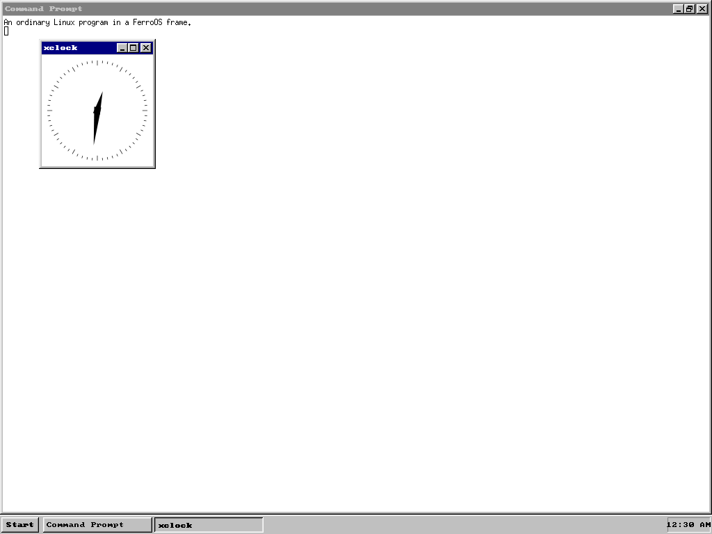
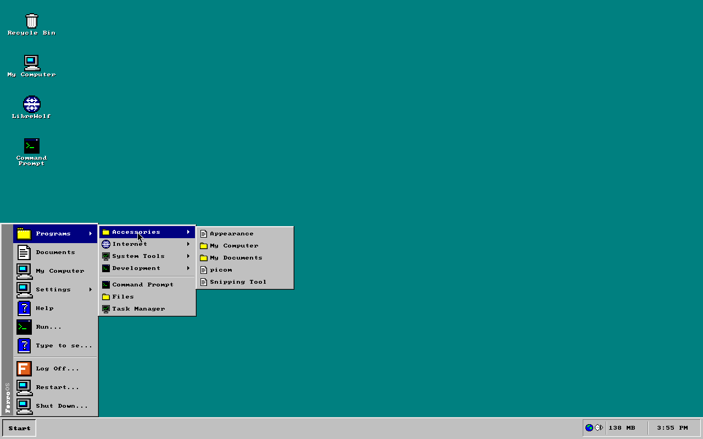
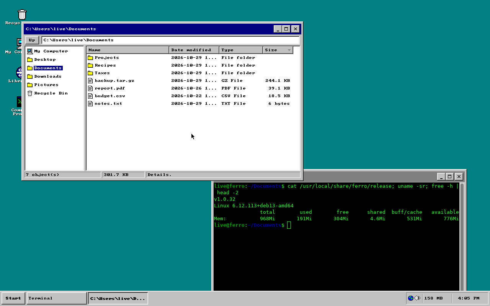
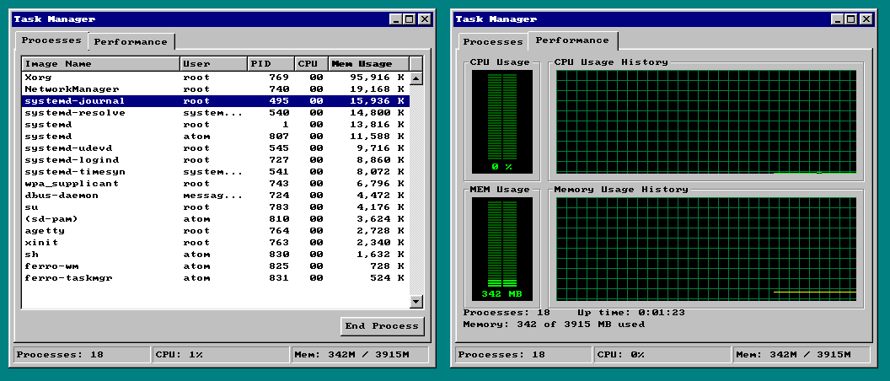
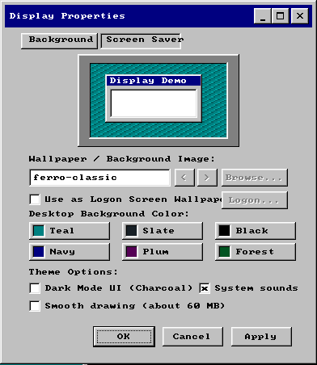
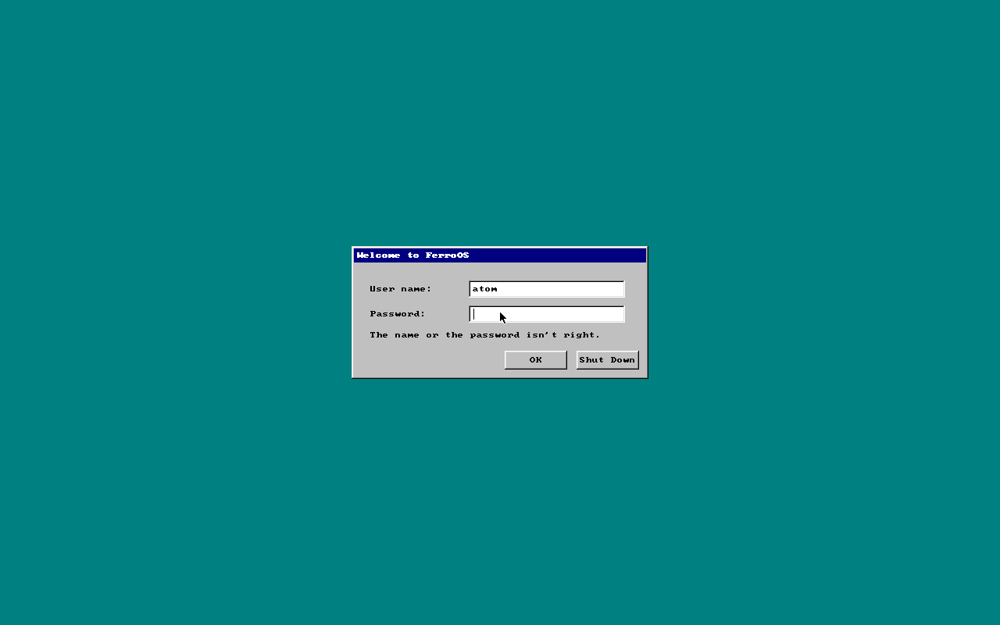
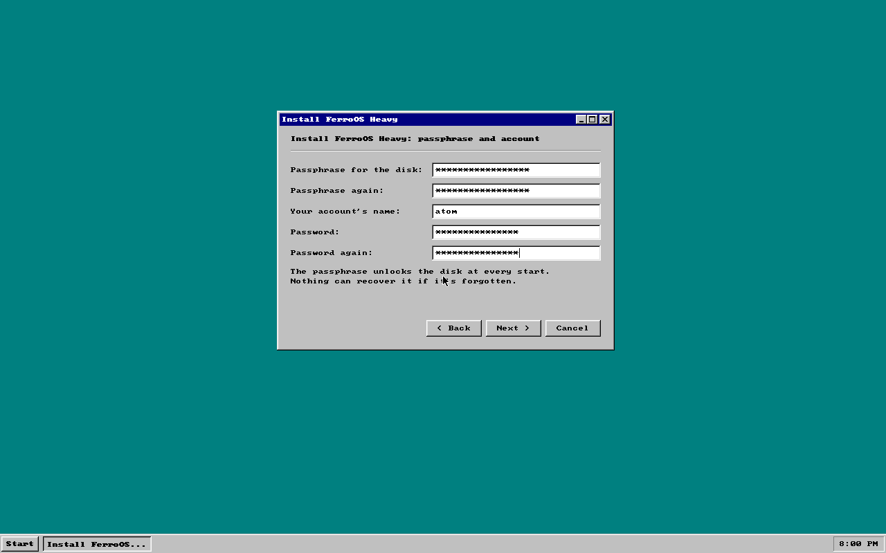
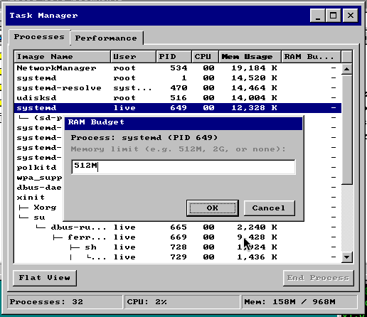
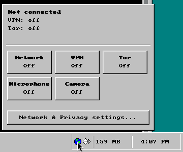

# FerroOS

A hardened, privacy-first operating system pairing an authentic Windows 95 desktop experience with the full power of modern Linux. Idling at **under 100 MB of RAM**, it runs native 3D games through Steam and Proton, NVIDIA/CUDA computing, and the complete Debian software ecosystem while enforcing uncompromising privacy by default: hardware kill switches in the system tray, per-app RAM limits, Landlock sandboxing, full-disk LUKS2 Argon2id encryption, duress self-destruct, and runtime physical memory scrubbing.



> **Heads up:** FerroOS is an independent privacy and systems engineering project. While built with defense-in-depth principles, it has not undergone formal third-party cryptographic auditing. For life-critical threat models, consider established systems such as Tails or Whonix.

---

## Heavy vs. Lite: Two Editions, One Vision

FerroOS is built from a unified codebase in two distinct editions tailored for different hardware targets:

| Feature / Metric | FerroOS Heavy *(Primary Edition)* | FerroOS Lite *(Embedded Companion)* |
|---|---|---|
| **Primary Focus** | Daily workstation, gaming, privacy, full Linux apps | Minimal footprint, air-gapped / embedded devices |
| **Base System** | Hardened Debian stable minbase | Custom Linux kernel + static Rust userspace (`ferro`) |
| **Idle RAM Footprint** | **Under 100 MB** | **~29 MB** (target < 50 MB) |
| **Display Server** | Xorg with lean `ferro-wm` (no Composite overhead) | Direct Linux DRM/KMS software framebuffer (`ferro-shell`) |
| **Hardware Graphics** | Intel Gen1–14, AMD Radeon, NVIDIA nouveau/proprietary, UEFI GOP | bochs, virtio-gpu, standard KMS modesetting |
| **3D & Gaming** | Native Vulkan, OpenGL, Steam/Proton, Mesa 3D | Isolated Debian glibc container |
| **Compute & AI** | On-demand NVIDIA CUDA, PyTorch, llama.cpp, Ollama | None |
| **Storage Encryption** | Full-disk LUKS2 (Argon2id PBKDF) with ephemeral swap | Custom Argon2id + XChaCha20-Poly1305 encrypted vault |
| **Boot Architecture** | Microsoft-signed shim + Debian signed GRUB & kernel | Microsoft-signed shim + unified kernel image |
| **Secure Boot** | Out-of-the-box (UEFI Secure Boot enabled) | MOK enrollment (`ferro-mok.der`) |
| **Anti-Forensics** | In-RAM key eviction on sleep, runtime memory scrubbing | Amnesic RAM-only mode, cold-boot page zeroing |
| **Duress Self-Destruct** | Anti-coercion PIN nukes LUKS2 headers & keyslots | Duress PIN nukes vault header & crypto keyslots |

---

## Download & Installation

Prebuilt hybrid ISO images are generated automatically via GitHub Actions:

1. Download **`ferroos-heavy.iso`** (or `ferroos.iso` for Lite) from the project's [GitHub Releases](https://github.com/anti-ghostsec/FerroOS/releases).
2. Flash the ISO to a USB flash drive using:
   - **[Rufus](https://rufus.ie)**: Select **DD Image Mode** when prompted (ensures all installer partition tables are preserved).
   - **[balenaEtcher](https://etcher.balena.io)**: Select image and flash directly.
   - **Linux / macOS**: `sudo dd if=ferroos-heavy.iso of=/dev/sdX bs=4M status=progress conv=fsync`
3. Boot your target PC:
   - **UEFI Secure Boot**: Supported out of the box with standard Microsoft-signed shim keys.
   - **Legacy BIOS**: Fully supported with hybrid MBR/GPT partitioning.
4. Choose between:
   - **Live Session**: Runs entirely in RAM. Nothing is written to physical drives.
   - **Install FerroOS**: Launches `ferro-setup` to install to an internal SSD/HDD with optional full-disk LUKS2 encryption.

---

## Desktop Experience

FerroOS Heavy delivers a responsive, nostalgic Windows 95 user interface designed for modern productivity without desktop environment bloat:

| | |
|---|---|
|  |  |
| *Authentic Windows 95 Start menu with cascading flyouts* | *File Manager with context menus & phosphor green prompt* |
|  |  |
| *Task Manager with per-process RAM quotas and performance graph* | *Display Properties CRT preview and window management* |

### Authentic Windows 95 Start Menu
- Dark embossed vertical banner ("FerroOS") and generous 34px item heights with crisp retro icons.
- **XDG Desktop Categorization**: Automatically categorizes standard desktop applications into classic cascading flyouts (*Accessories*, *Internet*, *Multimedia*, *System Tools*, *Development*, *Games*).
- **Multi-Column Horizontal Overflow**: When any menu or category exceeds available vertical screen height, items seamlessly split into side-by-side adjacent columns (authentic Windows 95 multi-column layout).
- **Instant Response & Zero-I/O Caching**: Desktop entries are indexed and cached in memory for instantaneous sub-millisecond menu response.
- **Visual Polish**: 3D etched dividers, uniform 16x16 raster icons, and classic flyout hover indicators.
- **Application Context Menus & Uninstall**: Right-click any application in the Start Menu or Programs submenu to **Open**, **Pin to Taskbar**, **Create Desktop Shortcut**, or **Uninstall...** (runs `sudo apt remove --purge` with package resolution).
- Quick shortcuts for *Programs*, *Documents*, *Settings*, *Help*, *Run...*, *Log Off...*, *Restart...*, and *Shut Down...*.

### Clean Desktop & Dynamic Filesystem Sync
- **Arranged Desktop Surface**: By default, **Recycle Bin** sits at the top `(20, 20)`, **Files** (system explorer) underneath `(20, 96)`, **LibreWolf** (privacy web browser) at `(20, 172)`, and **Command Prompt** (CRT green terminal) at `(20, 248)`.
- **Live `~/Desktop` Sync**: Any files, folders, or `.desktop` shortcuts created via the shell, terminal, or GUI appear on the desktop automatically.
- **Movable Icons & Persistence**: Drag icons freely across the desktop surface; custom positions persist across reboots in `~/.config/ferro/desktop.conf`. Deleting a preinstalled shortcut permanently hides it.
- **Hover Highlights & Selection**: Mousing over desktop shortcuts renders authentic Windows 95 focus outlines with drop-shadowed labels.
- **Desktop Icon Organization & Windows 11 Context Menu**:
  - Right-click desktop context menu:
    - **View**: Toggle **Auto arrange icons** and **Align icons to grid** (persisted across reboots in `~/.config/ferro/desktop.conf`).
    - **Sort by**: Arrange icons by *Name* or *Item type*.
    - **Refresh**: Instantly syncs and redraws desktop items from disk.
    - **New**: Create *Folder*, *Text Document*, or *Terminal Shortcut* directly on the desktop.
    - **Display settings**: Launches Appearance & Display Properties.
    - **Open in Terminal**: Opens Command Prompt in `~/Desktop`.
    - **Task Manager**: Direct shortcut to Task Manager.
  - Right-click desktop items: *Open*, *Pin to Taskbar*, *Create Desktop Shortcut*, *Rename...*, *Delete* (moves files to `~/.local/share/Trash`), *Empty Recycle Bin*.
- **Silky Smooth 60+ FPS Motion Pipeline**: Desktop and window movements utilize dirty-rectangle buffering, motion event compression, and deferred client IPC to ensure stutter-free, silky smooth dragging without low-FPS jumps.
- **Desktop Hotkeys**: Select any desktop item and press `Delete` to remove it, `Enter` to open or run it, or `F2` to rename it inline.

### Preinstalled Privacy & Media Applications (Heavy)
- **LibreWolf**: Hardened privacy browser with anti-fingerprinting, uBlock Origin, and zero telemetry out of the box.
- **MPV**: Lean, high-performance video player with hardware video acceleration (VA-API/VDPAU/CUDA).
- **qView**: Minimalist, instantaneous image viewer with retro aesthetic.
- **VeraCrypt**: Cross-platform encrypted container and volume manager.
- **Geany**: Fast, lightweight development environment and code editor.

### File Associations & System Defaults (`ferro-associations`)
- Accessible via `Start > Settings > File Associations...`.
- Graphical editor for file type associations stored in `~/.config/ferro/associations.conf`.
- Double-clicking documents in `ferro-files` or desktop shortcuts opens the associated application:
  - Text & Code (`.txt`, `.md`, `.rs`, `.c`, `.sh`, `.conf`) -> **Geany**
  - Images (`.png`, `.jpg`, `.jpeg`, `.bmp`, `.ppm`) -> **qView**
  - Media & Audio (`.mp4`, `.mkv`, `.avi`, `.mp3`, `.wav`, `.flac`) -> **MPV**
  - Web (`.html`, `.htm`) -> **LibreWolf**

### Taskbar Quick Launch & Pinning
- Pinned applications (Terminal, Files, Network) live in the Quick Launch area beside the Start button.
- Right-click any program or desktop shortcut and select **Pin to Taskbar** to add it to Quick Launch.
- Taskbar pins persist automatically in `~/.config/ferro/pinned.conf`.

### Audio Volume Control (`ferro-volume`)
- Dedicated retro speaker icon in the system notification tray.
- Click tray speaker to open authentic Windows 95 Master Volume slider with Mute toggle.
- Right-click tray speaker to instantly mute or unmute audio without opening the dialog.
- Automatically synchronizes with ALSA `amixer` and PulseAudio / PipeWire daemons.
- Operates silently by default with no intrusive system sounds or beeps.

### Date & Time Properties (`ferro-datetime`)
- Double-clicking the taskbar clock opens the authentic Windows 95 Date & Time Properties dialog.
- Interactive monthly calendar with month/year stepping and day selection.
- Real-time digital clock readout, authentic analog clock display, and current system timezone.

### Window Management & Geometry Persistence
- Windows remember their customized size and desktop position across sessions in `~/.config/ferro/windows.conf` (matching Windows 7 window memory).
- Dialogs, utility windows, and transient popups are cleanly isolated from parent window saved dimensions.
- **EWMH / NetWM Popup & Dropdown Menu Support**: Full conformance with `_NET_WM_WINDOW_TYPE_POPUP_MENU`, `_DROPDOWN_MENU`, `_TOOLTIP`, `_NOTIFICATION`, `_COMBO`, and `_DND`. Context menus and dropdowns (e.g., in LibreWolf/Firefox) map directly to their exact root screen coordinates without framing or clipping.
- Double-clicking the titlebar toggles window maximize.
- Instant, responsive caption buttons for Close (`X`), Maximize/Restore (`O`), and Minimize (`_`).
- Smooth 6px resize borders with 16px corner drag handles for seamless resizing.
- Aero Snap: Drag window titlebar to top to maximize, or left/right screen edges for 50% split view.

### Dedicated Network & Internet GUI (`ferro-network`)
- Accessible via `Start > Settings > Network & Internet...` or clicking the network icon in the system tray.
- Authentic Windows 95 tabbed property sheet dialog:
  - **Ethernet (LAN)**: Live wired interface information including link status, speed, MAC address, IPv4 address, subnet mask, default gateway, and active DNS resolvers. Features one-click **Renew IP (DHCP)**, **Disconnect**, and **Diagnose...** connectivity tests.
  - **Wi-Fi Networks**: Real-time wireless network scanning with signal strength indicators, security detection, modal password prompt dialog, and one-click Connect / Disconnect backed by NetworkManager (`nmcli`).
  - **VPN & Tor**: Full GUI toggle for Arti Tor daemon, bridge configuration, and WireGuard VPN tunnel status.
  - **Hardware Switches**: Dedicated toggles for Network, Microphone, and Camera hardware kill switches.
- **Out-of-the-Box Ethernet Auto-Connect**: Wired Ethernet interfaces automatically configure and connect with DHCP on boot or cable plug-in via NetworkManager and firewall rules (`udp sport 67 udp dport 68`).

### Power & Session Management
- Instant, passwordless power actions from the Start menu (*Shut Down...*, *Restart...*, *Standby (Encrypted Sleep)...*, *Log Off...*).
- Polkit and sudoers rules allow user accounts in the `sudo` group to poweroff, reboot, and sleep without terminal prompts or permission denials.

### Desktop Appearance & Screensavers (`ferro-appearance`)
- Accessible from `Start > Settings > Appearance...` or right-clicking the desktop.
- Features a retro CRT monitor preview rendering the selected background or screensaver in real time.
- **Background Tab**:
  - Cycle through discovered image wallpapers (`.bmp` and `.ppm`) or select solid colors.
  - **Logon Screen Wallpaper**: Toggle "Use as Logon Screen Wallpaper" to seamlessly sync background images to `ferro-logon`.
  - **Six Retro Desktop Colors**: *Classic Teal* (`#008080`), *Dark Slate* (`#182026`), *Obsidian Black* (`#000000`), *Retro Navy* (`#000080`), *Plum* (`#550055`), and *Forest Green* (`#005522`).
  - **Dark Mode UI**: Toggle between classic silver/gray 3D bevels and a modern Charcoal Dark Mode for window borders and dialogs.
- **Screen Saver Tab**:
  - Choose between *Flying Stars*, *Phosphor Matrix*, *Blank Screen*, or custom screensavers.
  - Adjust idle activation timeout (1–60 minutes) and toggle password protection on wake.
  - Full-screen **Preview** button and quick shortcut button to open the custom screensavers folder.
- Changes broadcast instantly to running apps via X11 root window atoms and persist across reboots in `~/.config/ferro/appearance.conf`.

### Retro Screensavers & Screen Lock (`ferro-screensaver` / `Win+L`)
- Authentic retro screensavers:
  - **Flying Stars**: 3D starfield warp animation with depth perspective.
  - **Phosphor Matrix**: Retro green phosphor cascading digital rain.
  - **Blank Screen**: Energy-saving power black display.
- **Custom Screensavers**: Drop any executable or shell script into `~/.local/share/ferro/screensavers/` to automatically register it in the Appearance picker.
- **Instant Lock (`Win+L`)**: Press `Win+L` at any time to instantly lock the screen and require user authentication.

### System Tray & Hardware Kill Switches
- Located in the taskbar notification area beside the clock and volume controls.
- One-click privacy kill switches for **Network**, **Microphone**, and **Camera**.
- **Privacy by Default**: Microphone and camera hardware are disabled at boot (indicated by bold red slashes). Clicking toggles the kernel device state and updates system permissions.
- Real-time system memory usage is displayed next to the clock (`XX MB  HH:MM AM`); clicking opens Task Manager.

### Task Manager & Process Context Menus (`ferro-taskmgr`)
- Accessible via `Ctrl+Shift+Esc`, the tray clock, or the Start menu.
- **Processes Tab**: Real-time PID, CPU%, memory footprint, user account, and active **RAM Budget**.
- **Right-Click Process Context Menu**: Right-click any running process to **End Process**, **Set Budget...**, or **Remove Budget**.
- **Per-Process RAM Quotas**: Set strict kernel cgroup v2 memory limits (e.g., `512M`, `2G`) with dedicated dialog; button properly padded without text overflow.
- **Performance Tab**: Live 60-second CPU and RAM history graphs featuring a visual threshold line referencing Heavy's 100 MB idle memory target.

### Green Phosphor Command Prompt (`ferro-cmd`)
- Launches in a retro terminal styled after phosphor CRT monitors (`#33FF33` bright green text on `#000000` deep black).
- DOS-compatible commands: `DIR`, `CD`, `TYPE`, `MEM`, `PS`, `RUN`, `CLS`, `HELP`.
- Integrated FerroOS utilities for network, power, and package management.

---

## Security, Privacy & Anti-Forensics

FerroOS Heavy embeds layered defense-in-depth across the entire operating system stack:

### Optional Full Disk Encryption (LUKS2 + Argon2id)
- The installer (`ferro-setup` / `ferro-install`) configures LUKS2 full-disk encryption using memory-hard Argon2id key derivation by default.
- Users can uncheck encryption during setup for non-sensitive environments or virtual machine testing.
- Swap space uses ephemeral keys derived from `/dev/urandom` on every boot; residual data is destroyed the moment power is cut.

### Duress Password & Anti-Coercion Self-Destruct
- During setup, an optional secondary **Duress PIN** can be configured alongside your primary password.
- If entered under physical coercion at the logon screen or unlock prompt, the system instantly:
  1. Overwrites LUKS2 partition headers and key slots with cryptographic entropy.
  2. Nukes vault master keys from active RAM.
  3. Purges all dirty filesystem buffers and forces an immediate hard poweroff.
- To an adversary observing the screen, the action appears as an ordinary "Incorrect Password" prompt.

### Cold-Boot Memory Extraction Defense
- The kernel boots with `init_on_alloc=1` and `init_on_free=1`.
- Every physical memory page freed by any process or kernel cache is immediately zeroed by the Linux memory allocator.
- Freelist randomization (`page_alloc.shuffle=1`) and slab cache isolation (`slab_nomerge`) prevent heap exploitation and leave no plaintext keys or credentials in RAM chips after use.

### Encrypted Suspend & In-RAM Key Eviction
- Standard ACPI sleep leaves master encryption keys vulnerable in DRAM to cold-boot and DMA hardware attacks.
- On FerroOS Heavy, entering sleep or closing a laptop lid activates automated systemd hooks (`/lib/systemd/system-sleep/60-ferro-encrypted-sleep.sh`):
  - Active disk buffers are flushed and synchronized.
  - Page and inode caches are dropped and compacted (`drop_caches=3`, `compact_memory=1`).
  - Active dm-crypt LUKS2 mappings (`ferro-system`) are suspended with `--noflush` key eviction.
  - Upon waking, the system requires full password re-authentication before master keys can be restored.

### Tor Routing with Pluggable Transports
- Built-in Arti (Rust implementation of Tor) with native Pluggable Transport support (`lyrebird`, `snowflake-client`, `webtunnel-client`).
- Disabled by default. Can be enabled per-session (`TOR ON`) or made persistent (`TOR ON PERSIST`).
- Add bridges via `TOR BRIDGE ADD <line>`, list with `TOR BRIDGE LIST`, and clear with `TOR BRIDGE CLEAR`.

### System Hardening & Network Privacy
- **Encrypted DNS**: System-wide DNS-over-TLS (DoT) via Quad9 and Mullvad with DNSSEC validation; local ISP DNS is never queried.
- **MAC Address Randomization**: Ephemeral MAC addresses generated for every Ethernet and Wi-Fi connection, including during Wi-Fi probe scanning.
- **Default-Deny Firewall**: `nftables` drops all inbound connections while permitting outbound traffic and essential ICMP/DHCPv6.
- **Restricted Umask**: Files created by users default to private permissions (`umask 077`).
- **Kernel Lockdown**: `lockdown=integrity`, `kptr_restrict=2`, `dmesg_restrict=1`, `yama.ptrace_scope=1`, `unprivileged_bpf_disabled=1`, core dumps disabled (`suid_dumpable=0`), and maximum ASLR entropy (`mmap_rnd_bits=32`).
- **Metadata Removal**: Right-click images to strip EXIF, GPS, camera model, and author metadata.

---

## Modern Hardware & On-Demand Capabilities

FerroOS Heavy includes driver support for modern workstations and laptops, with on-demand acceleration tools accessible via `ferro-heavy` or the Start menu:

```bash
ferro-heavy status     # View RAM footprint, Secure Boot, LUKS, GPU, and audio status
ferro-heavy steam      # Configure 32-bit architecture, Vulkan loaders & Proton for Steam
ferro-heavy nvidia     # Build proprietary NVIDIA DKMS drivers + libcuda + MOK enrollment
ferro-heavy llm        # Install Python 3, PyTorch, and tools for local LLM inference (llama.cpp, Ollama)
ferro-heavy cuda       # Install full NVIDIA CUDA compiler toolkit (nvcc & headers)
ferro-heavy drivers    # Install Mesa 3D acceleration & VA-API video decode for Intel / AMD
ferro-heavy audio      # Configure ALSA sound utilities & optional PipeWire emulation
```

- **Wi-Fi Cards**: Firmware included out of the box for Intel (`iwlwifi`), Realtek (`rtw88`/`rtw89`), MediaTek (`mt7921`/`mt7922`), Qualcomm Atheros (`ath10k`/`ath11k`), and Broadcom.
- **Display Drivers**: Modesetting for Intel Gen1–Gen14, AMD Radeon (`amdgpu`), NVIDIA (`nouveau`), with universal UEFI GOP (`fbdev`) and VESA fallbacks.
- **Audio**: Zero-daemon ALSA utilities (`alsa-utils`) and Sound Open Firmware (`firmware-sof-signed`) support laptop internal speakers and digital microphone arrays.

---

## Under 100 MB Idle RAM: How It Works

Standard desktop Linux distributions consume between 800 MB and 2.5 GB of RAM at idle. FerroOS Heavy achieves sub-100 MB idle memory through targeted systems optimization:

1. **Kernel Hash Table Pinning**: Linux dynamically sizes internal dcache, icache, and page hash tables based on total system RAM—consuming 30–50+ MB on modern machines. Heavy pins these tables at boot (`dhash_entries=32768 ihash_entries=16384 thash_entries=4096 uhash_entries=512`), freeing dozens of megabytes immediately.
2. **Transparent Hugepage Suppression**: Booting with `transparent_hugepage=never` prevents the kernel from allocating 2 MB hugepages to small background daemons, avoiding memory fragmentation.
3. **Zero Composite Window Overhead**: `ferro-wm` renders window frames and widgets directly in software. Disabling the Xorg Composite extension (`Option "Composite" "Disable"`), RECORD, and XTEST eliminates 15–20+ MB of off-screen backing pixmaps.
4. **Aggressive Cache Reclaim**: `vm.vfs_cache_pressure=200` and `vm.swappiness=10` aggressively prioritize reclaiming unused directory/inode caches.
5. **Capped Journal Buffers**: `systemd-journald` volatile runtime storage is capped at 4 MB (`RuntimeMaxUse=4M`) with compression enabled (`Compress=yes`).
6. **Lean NetworkManager**: Configured with internal C DHCP client (`dhcp=internal`), file-only keyfile plugins, and connectivity polling disabled.
7. **Masked Redundant Daemons**: Virtual consoles `tty3`–`tty6`, background APT timers, and non-essential disk scrubbers are masked to eliminate background CPU and RAM wakeups.

---

## FerroOS Lite: The 29 MB Companion

For embedded systems, retro machines, or air-gapped environments where every megabyte counts, FerroOS Lite runs the same retro user experience in an ultra-compact package:

- **Monolithic Rust Userspace**: The entire userspace (PID 1 `ferro-init`, `ferro-shell`, `ferro-net`, `ferro-cmd`) is compiled into a single static binary.
- **Direct DRM/KMS Rendering**: Renders straight to the Linux kernel Direct Rendering Manager framebuffer without X11 or Wayland.
- **Encrypted Vault**: User files and settings reside in a custom cryptographic vault encrypted with Argon2id and XChaCha20-Poly1305.
- **Zero Disk Residue**: The root filesystem runs purely in RAM; shutdown wipes all uncommitted data.

---

## Keyboard Shortcuts & Commands

### Global Keyboard Shortcuts

| Shortcut | Action |
|---|---|
| `Win` or `Ctrl + Esc` | Open / close Start menu |
| `Ctrl + Shift + Esc` | Launch Task Manager (`ferro-taskmgr`) |
| `Win + E` | Open File Manager (`ferro-files`) |
| `Win + D` | Show Desktop (minimize / restore all windows) |
| `Alt + F4` | Close active window |
| `Alt + Tab` | Cycle between open windows |

### Useful Terminal Commands

```text
DIR / CD / TYPE         Standard file navigation and inspection
MEM                     Display free, used, and total system memory
MEM /DETAIL             Detailed memory breakdown including kernel tables
RUN /NET <app>          Launch an application with pre-authorized network access
PERMS /FORGET ALL       Clear all remembered application network permissions
WIFI LIST               Scan and list available Wi-Fi networks
WIFI JOIN <ssid>        Connect to a Wi-Fi network (prompts for passphrase)
BATTERY                 Query laptop battery charge level and AC power status
BRIGHTNESS <0-100>      Adjust display backlight brightness
VPN IMPORT <path.conf>  Import a WireGuard configuration file
VPN ON / VPN OFF        Toggle WireGuard VPN tunnel
TOR ON / TOR OFF        Toggle system-wide Tor routing
DEBIAN apt install <pkg> Install any Debian package (with persistent LUKS2 storage)
```

---

## Building from Source

### Prerequisites

- [Rust](https://rustup.rs) (stable toolchain)
- [QEMU](https://www.qemu.org) (`qemu-system-x86_64`)
- Host C compiler (`clang`, `llvm`, and `musl-tools` on Linux; MinGW GCC on Windows)

The build toolchain compiles the system inside isolated, self-contained QEMU builder VMs—no cross-compilation toolchains or container engines required.

```bash
# 1. Preview the desktop in a window on your current operating system
cargo run -p ferro-preview

# 2. Build FerroOS Heavy hybrid ISO (build/ferroos-heavy.iso)
cargo xtask heavy-iso

# 3. Run automated virtual window manager test suite with screenshots
cargo xtask wm-test

# 4. Build FerroOS Lite standalone ISO (build/ferroos.iso)
cargo xtask iso

# 5. Boot FerroOS Lite in QEMU with 64 MB RAM
cargo xtask run
```

### Automated GitHub Releases

Automated releases are powered by the `.github/workflows/release.yml` GitHub Actions workflow. When a version tag (e.g. `v1.0.0`) is pushed or manually triggered via `workflow_dispatch`:
- The builder automatically provisions the environment, compiles the static userspace binaries, and generates `ferroos-heavy.iso`.
- Computes SHA-256 checksums (`ferroos-heavy.iso.sha256`).
- Publishes the release assets to GitHub Releases with changelog details.

---

## Screenshots

| Logon Screen | Installation Wizard |
|:---:|:---:|
|  |  |
| *Logon screen with session locking & duress protection* | *Setup wizard with optional full-disk LUKS2 encryption* |

| Task Manager Budgets | Network Kill Switches & Tray |
|:---:|:---:|
|  |  |
| *Per-process RAM budget configuration dialog* | *Hardware kill switches and privacy controls* |

---

## License

FerroOS is dual-licensed under the [MIT License](LICENSE-MIT) or the [Apache License (Version 2.0)](LICENSE-APACHE), at your option.

Third-party components packaged in the installation images:
- Linux Kernel: GPL-2.0
- GRUB Bootloader: GPL-3.0
- Arti (Tor): MIT / Apache-2.0
- Debian Base Packages: Respective upstream open-source licenses
